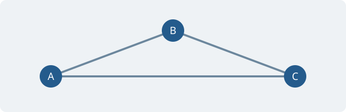

이 글은 **로컬 확인용 샘플**입니다. 실제 배포의 페이지·목록·RSS에서는 제외됩니다. 상단의 해와 달 버튼으로 테마를 바꾸면서 읽어 보세요.

## 본문과 강조

사람들의 이동과 활동에서 나타나는 패턴과 변화에 관심이 있습니다. 한글 본문과 English text, 숫자 0123456789가 함께 놓였을 때의 읽기 편안함을 확인합니다. 문장이 길어지면 화면 너비에 맞춰 자연스럽게 줄이 바뀝니다.

**굵은 글씨**, *기울임*, ~~취소선~~, [About 페이지](/about/), 인라인 코드 `published: false`를 비교합니다. 달러 기호 자체는 \$100처럼 씁니다.

### 소제목 · H3

문단과 제목 사이의 여백, 본문 줄 간격을 확인하는 문장입니다.

#### 작은 소제목 · H4

짧은 설명이나 세부 항목에 사용하는 제목입니다.

## 목록과 인용문

- 첫 번째 항목
- 두 번째 항목에는 **강조**와 `인라인 코드`가 있습니다.
  - 중첩 항목 하나
  - 중첩 항목 둘

1. 문제를 정의합니다.
2. 데이터와 가정을 확인합니다.
3. 결과를 비교하고 한계를 기록합니다.

- [x] 라이트·다크 모드 확인
- [ ] 모바일에서 긴 수식과 표 확인

> 예측은 관측의 결과이면서, 때로는 다음 행동의 입력이 됩니다.
>
> 여러 문단으로 이루어진 인용문도 표시할 수 있습니다.

---

## 수식

문장 속 수식 $t(x)=a+bx$와 아래첨자 $x_i$, 위첨자 $x^2$, 그리스 문자 $\alpha,\beta$를 확인합니다.

독립된 수식은 별도 줄에 놓습니다.

$$
\mathrm{MSE}=\frac{1}{n}\sum_{i=1}^{n}(y_i-\hat{y}_i)^2
$$

여러 줄의 식과 조건부 정의도 사용할 수 있습니다.

$$
\begin{aligned}
t_A(x) &= 10 + 0.5x \\
t_B(x) &= 20 + 0.2x
\end{aligned}
$$

$$
f(x)=\begin{cases}
0 & x < 0 \\
x^2 & x \ge 0
\end{cases}
\qquad
A=\begin{pmatrix}1 & 2 \\ 3 & 4\end{pmatrix}
$$

다음은 작은 화면에서 가로 스크롤을 확인하기 위한 의도적으로 긴 수식입니다.

$$
\mathcal{L}(\theta)=\underbrace{\frac{1}{n}\sum_{i=1}^{n}\bigl(y_i-f_{\theta}(x_i)\bigr)^2}_{\text{prediction error}}+\underbrace{\lambda\sum_{j=1}^{p}\theta_j^2}_{\text{regularization}}+\underbrace{\gamma\sum_{k=1}^{m}\bigl(t_k(x_k)-\bar{t}\bigr)^2}_{\text{travel time variation}}
$$

## 코드

한글 주석과 구문 강조를 확인합니다. 코드도 현재 블로그 설정대로 SUIT를 사용합니다.

```python
def travel_time(flow: float, base: float = 10.0) -> float:
    # 교통량에 따른 통행시간 계산
    return base + 0.5 * flow

results = [travel_time(flow) for flow in range(5)]
print(results)
```

```javascript
// 긴 줄은 코드 블록 안에서 가로로 스크롤됩니다.
const sample = { origin: "서울", destination: "수원", travelTime: 45, description: "긴 코드가 페이지 전체 너비를 늘리지 않는지 확인하는 예시입니다." };
```

```text
언어를 지정하지 않아도 텍스트 블록을 쓸 수 있습니다.
비례폭 글꼴이므로 공백으로 맞춘 열은 정확하게 정렬되지 않을 수 있습니다.
```

## 표

아래 값은 표시 확인을 위한 가상 데이터입니다. 좁은 화면에서는 표 안에서 가로로 이동합니다.

| 시나리오 | 교통량 | 평균 통행시간 | 예측 오차 | 비고 |
| :--- | ---: | ---: | ---: | :--- |
| 기준 | 1,000 | 32.5분 | 2.1분 | 비교 기준 |
| 경로 안내 적용 | 1,200 | 35.8분 | 1.8분 | 행동 변화 포함 |
| 수요 분산 | 950 | 29.3분 | 2.4분 | 가상의 실험 결과 |

## 이미지



이미지는 본문 폭 안에 들어오도록 표시됩니다. 위 그림은 이 샘플을 위해 만든 벡터 이미지입니다.

## 각주와 접기

본문의 부연 설명을 각주로 옮길 수 있습니다.[^sample]

<details>
<summary>추가 설명 펼치기</summary>
<p>기본 HTML의 details 요소입니다. 별도의 JavaScript 없이 설명을 접거나 펼칠 수 있습니다.</p>
</details>

[^sample]: 표시를 확인하기 위한 각주입니다. 각주 번호와 본문으로 돌아가는 링크도 확인해 보세요.
